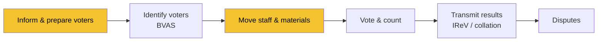
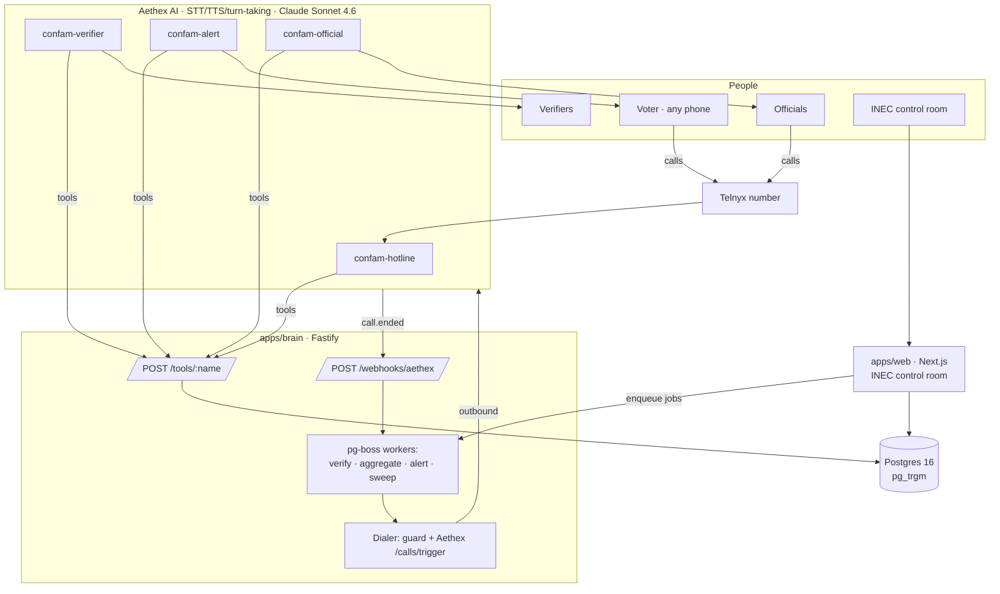
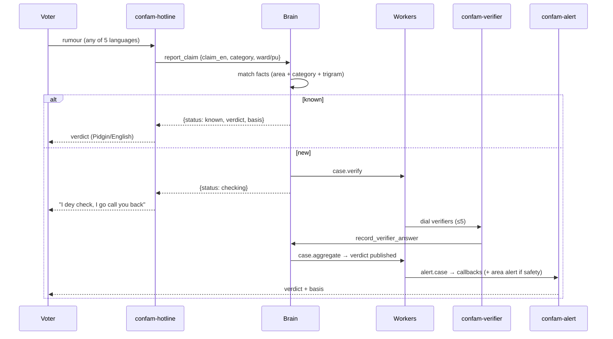

# Confam: Architecture

> Status: **v2, approved for build** · 2026-11-19 · decisions log in §17
> "Confam" is Nigerian slang for "confirmed". Call it, and it confirms.

## 1. Overview

### The big picture (the voting chain)

**Our weak link is #1, voter information and misinformation, which extends into #3 (visibility of staff and materials).** Every later link depends on people trusting what they hear. Amaka's day goes wrong at three points: her PU moved, the officials were late, and nobody could tell her what was true. All three are failures of information, and all three can be fixed with one phone call that anyone can make in their own language.

### Product
**Confam is a phone line, not an app.** It works from any phone. Callers **speak** English, Pidgin, Yoruba, Hausa or Igbo, and Confam **answers** in Nigerian Pidgin or Nigerian English. Native Yoruba, Hausa and Igbo voices switch on when Aethex enterprise access arrives (research §8–10). Confam does four jobs:

1. **Verify rumours.** A caller reports a rumour. If Confam already knows the answer, it says so immediately. If not, it **phones trusted people in that ward** (community leaders, observers, party agents from different parties), combines their answers automatically, and **calls back** everyone who reported it with the verdict and its basis.
2. **Proactive alerts.** When INEC (the dashboard) records a PU relocation, Confam calls every subscribed voter of that PU. This does not rely on an SMS that may never be read.
3. **Track staff.** Polling officials check in by voice ("I don reach", "materials don land", "voting don start"). Voters can ask "have the officials reached my PU?". If no one has checked in by the deadline, Confam calls the officials, then their supervisor, and reports back.
4. **Elderly and disabled voter support (light).** Voters register needs by voice. Confam tells them their legal rights (priority queue, a helper of their choice, s.54 Electoral Act 2026), alerts the PU officials ahead of time, and calls them with a "go now" message once officials have arrived. **Voting by phone is illegal** (s.55 requires personal attendance), so it is out of scope (research §7).

**Users:** voters, trusted verifiers, polling officials (PO) and supervisors, and the **INEC control room** (the dashboard operators).

### Success metrics (demo)
- A known rumour gets an in-call verdict in **< 10 s**.
- A new rumour gets an automatic verdict from ≥ 2 verifier answers and a callback to the reporter in **< 10 min**.
- A PU relocation reaches every callable subscriber, with each call attempt logged.
- A late PU triggers an official call within one sweep (5 min).
- Agent replies feel live (Aethex turn latency; no added pipeline hops).

## 2. Scope
**In scope**
- Inbound voice line (Aethex agent on the Telnyx number). Callers may speak any of 5 languages. Replies are in Pidgin or English.
- Rumour intake → match → verifier calls → automatic aggregation → callbacks and area alerts.
- Voter subscription by voice (consent, PU, accessibility needs).
- PU relocation alerts (batch outbound).
- Official check-ins, lateness sweep and escalation, voter status queries.
- Accessibility needs registry, rights explainer, PO pre-notification and "go now" call.
- **INEC control room dashboard:** live rumour board, verification progress, PU and staff map, notices, people directory, call log, **pause-all-outbound switch**, and manual override of any verdict.

**Out of scope (and why)**
- Phone voting (illegal under s.55, research §7). Results verification (a different weak link). Flash-to-callback line (only useful with a +234 number). WhatsApp and USSD (later). Native Yoruba, Hausa and Igbo **speech output** (enterprise-gated at Aethex; switched on by config when access arrives).

**Assumptions and constraints**
- **Demo number is US (+1 864 808 9401).** Production uses a Nigerian +234 DID. Outbound calls depend on Telnyx account verification (pending on the user's side). Inbound works independently.
- **Demo data:** the 12 real INEC ward names of **Surulere LGA, Lagos**. Demo PUs, voters, verifiers and officials are seeded and marked `is_demo`. **Only numbers in `DEMO_TEAM_PHONES` (the team's real phones) are ever dialled.** Calls to demo contacts are recorded as `skipped_demo_contact` and never placed. INEC's PU locator is behind a captcha and its directory PDF is offline, so we do not scrape it.
- Fully automatic: no human approval step. Safety comes from the verdict rule (§7), the pause switch and overrides.
- Nigeria Data Protection Act 2023: voice consent before subscribing, purpose limitation, and unsubscribe by voice.

## 3. Requirements
**Functional**
- F1. The hotline understands callers in English, Pidgin, Yoruba, Hausa or Igbo. English callers get English. Everyone else gets Pidgin.
- F2. The agent extracts a rumour's claim (normalised English), category and location (ward and/or PU) and calls `report_claim`.
- F3. If a published verdict matches (same area, same category, text similarity ≥ threshold, still valid), the agent states it and its basis in the same call.
- F4. Otherwise a case opens, or the report joins an open case in the same area and category. The caller hears "I dey check, I go call you back".
- F5. Up to 5 callable verifiers in the ward (then the LGA) get a call. The verifier agent asks one yes/no/unknown question and records the answer through a tool.
- F6. **Automatic verdict:** ≥ 2 independent answers agreeing with weighted agreement ≥ 0.7 gives CONFIRMED or FALSE. At the deadline with no agreement, the verdict is UNVERIFIED. The verdict is published as a fact immediately.
- F7. On publish, every reporter of the case gets a callback. For safety categories (violence, intimidation), area subscribers also get the alert.
- F8. Voters subscribe by voice (consent, PU, needs) and can unsubscribe by voice.
- F9. The control room records a PU relocation, and every callable subscriber of that PU gets an outbound alert.
- F10. Officials check in by voice (arrived / materials / voting_started / issue). They are identified by caller ID and a 4-digit PIN.
- F11. Voters ask about PU status and hear the latest check-ins with times.
- F12. A lateness sweep (every 5 min on election day) calls the PO when there is no `arrived` by the deadline, then the supervisor 15 min later if still unresolved.
- F13. Voters with accessibility needs hear their rights. The PO is told in advance, and the voter gets a "go now" call after `arrived`.
- F14. The dashboard shows cases, verifier answers, verdicts, PU statuses, check-ins, notices and calls live. It has a pause switch and verdict override.

**Non-functional**
- Tool endpoints respond in **≤ 2 s p95** (Aethex hard timeout is 9 s, with no retries).
- Webhooks are verified (HMAC), idempotent (`event_id`) and acknowledged in < 1 s, with work done in jobs.
- Outbound calls respect the pause switch, quiet hours outside election day, a per-person cooldown and the demo-contact guard.
- Dashboard is WCAG 2.2 AA and has calm, purposeful motion (house rules).
- Security: secret tool header plus agent-id check, signed webhooks, an authenticated dashboard, phone numbers stored hashed and encrypted, no PII sent to logs.

## 4. System context & high-level design

**Path of a rumour.** Amaka calls in and says (in Yoruba) "they say there's fighting at Ojuelegba". The hotline agent calls `report_claim` with `{claim_en, category: violence, ward: "YABA/OJUELEGBA"}`. The brain finds no matching fact, so it opens a case and enqueues `case.verify`. The worker picks the callable verifiers in that ward and the dialer triggers `confam-verifier` calls. Each verifier answers, and the agent calls `record_verifier_answer`. After each answer, `case.aggregate` checks the rule: 2 of 2 say "no", so the verdict is FALSE. It is published as a fact, and `alert.case` calls Amaka back in Pidgin: "We don check am. Two people for Ojuelegba confam say nothing like fight dey. Voting dey go on well." The dashboard shows each step live.

## 5. Tech stack
| Layer | Choice | Why | Rejected |
|---|---|---|---|
| Carrier | **Telnyx** (+1 demo, +234 prod) | Already purchased. Aethex has a native Telnyx integration | — |
| Voice runtime | **Aethex AI** agents, `language: english` | Tested: its STT transcribes Yoruba, Hausa, Igbo and Pidgin near-verbatim. Nigerian voices. Custom tools, batch outbound, signed webhooks, voicemail detection | Gemini Live / OpenAI Realtime (Yoruba speech poor in the user's test, and we'd own the media plumbing). Spitch pipeline (2–4 s turns) |
| Agent LLM | **`claude-sonnet-4-6`** from the Aethex catalog | Tested: understands Yoruba, Hausa and Igbo, replies in Pidgin | Haiku (weaker on low-resource languages) |
| Voices | **Segun** (male), **Ifeoma** (female), NG English | Clear in Pidgin and English samples | — |
| Backend | **Node 24 + TypeScript (strict) + Fastify 5 + Zod** | Fast tool responses, typed boundaries | Next.js route handlers (cold starts in the tool path) |
| Jobs | **pg-boss 10** | Durable jobs, retries, cron and singleton keys on Postgres | Redis/BullMQ |
| DB | **Postgres 16 + Drizzle ORM + pg_trgm** | One store. Trigram similarity for claim matching, no embedding vendor needed | pgvector + embedding API (extra key and latency, not needed at demo scale) |
| Dashboard | **Next.js 15 App Router + Tailwind 4 + Motion + GSAP**, MapLibre GL | House stack. Server components read the DB, server actions enqueue jobs, SSE for live updates (Postgres LISTEN/NOTIFY) | SPA |
| Auth (dashboard) | Email + password (argon2id), signed httpOnly session cookie (jose), roles `admin` / `viewer` | No email provider needed | Magic links (needs SMTP) |
| Tests | Vitest, Testcontainers Postgres, Playwright, `motion-check.mjs` | — | — |
| Hosting | **Railway** (brain, web, Postgres) | CLI available, private networking | — |
| Monorepo | **npm workspaces**: `packages/db`, `apps/brain`, `apps/web` | Shared schema and job names | — |

## 6. Components
**6.1 Aethex agents** (created idempotently by `apps/brain/scripts/provision-aethex.ts`. Prompts live in `apps/brain/src/prompts/` and are versioned in git.)
| Agent | Direction | Purpose | Tools |
|---|---|---|---|
| `confam-hotline` | inbound | Front door: identify caller, rumour intake, PU lookup and status, subscribe/unsubscribe, accessibility, official check-in (PIN) | `identify_caller`, `lookup_polling_unit`, `report_claim`, `pu_status`, `subscribe`, `unsubscribe`, `request_accessibility_support`, `official_checkin` |
| `confam-verifier` | outbound | Asks one question about a case. Variables: `verifier_name`, `case_question`, `location_name`, `case_id` | `record_verifier_answer` |
| `confam-alert` | outbound | Delivers a verdict, relocation or "go now" message. Variables: `alert_script`, `alert_id`. Voicemail: leave message | `confirm_alert_heard`, `unsubscribe` |
| `confam-official` | outbound | Calls a late PO or supervisor to get an ETA or problem | `official_checkin` |

**Language policy (all prompts):** understand English, Pidgin, Yoruba, Hausa and Igbo. Reply in English to English speakers and in simple Nigerian Pidgin to everyone else. Never output Yoruba, Hausa or Igbo words (the voice can't pronounce them) or emoji. Briefly restate what you understood. Keep turns ≤ 2 sentences.

**6.2 Tools** `POST /tools/:name`. Auth: header `x-confam-tool-key` plus an allowlist of agent IDs per tool. The body is the Aethex envelope `{arguments, agent_id, conversation_id, call_id}` and is Zod-validated. Every response includes `say` (a short speakable hint). Failures return `200 {error, say}` so the agent recovers gracefully. Caller phone comes from the call record (`GET /calls/:id`, cached per call), never from LLM arguments.

**6.3 Webhooks** `POST /webhooks/aethex`: verify `X-Aethex-Signature` (`t=…,v1=…`, HMAC-SHA256 over `"<t>.<raw body>"`, ±300 s, constant-time), dedupe on `event_id`, enqueue, return 200. `call.ended` updates the `call` row (status, duration, cost, transcript) and finalises any outbound attempt.

**6.4 Workers (pg-boss)**
- `case.verify`: choose verifiers (ward first, then LGA; callable; diverse roles; reputation order; max 5; cooldown), create `verification_request`s, dial.
- `case.aggregate` (singleton per case, runs after every answer and at the deadline): apply the verdict rule (§7), publish the fact, then enqueue `alert.case`.
- `alert.case` / `alert.notice` / `alert.go_now`: build recipients, create `alert` rows, dial.
- `sweep.lateness` (cron `*/5 * * * *`, active on election day only): find PUs past `opening_deadline` with no `arrived`, dial the PO, escalate to the supervisor after 15 min.
- `call.retry`: one retry after 3 min on no-answer/busy for verifier and alert calls.

**6.5 Dialer.** It is the only code path to `/calls/trigger`. In order, it checks: `system_settings.outbound_paused`, `person.is_demo` (logs `skipped_demo_contact` and never dials), the number being in the `DEMO_TEAM_PHONES` allowlist when `DEMO_MODE=true`, a cooldown of 1 call per person per 2 min per purpose, and quiet hours. It records an `outbound_attempt` for every decision. On Aethex 4xx/5xx it records the error (for example, Telnyx outbound not verified) and the job retries with backoff for 5xx and 429 only.

**6.6 Dashboard (apps/web): "INEC Control Room"**
- **Overview:** live counters, activity feed, and the pause-all switch.
- **Rumours:** case board (open → verifying → published) and case detail (reports, verifier answers, verdict, override).
- **Polling units:** map and table by ward, status, check-in timeline, create relocation notice (with a preview of how many will be called and how many are demo contacts).
- **People:** voters, verifiers, officials and supervisors. Add/edit/assign PU and role, issue official PIN, mark demo/team.
- **Calls:** every inbound and outbound call with its transcript, plus outbound attempts including skipped and errored ones.
- **Settings:** election day toggle and opening deadline, verdict thresholds, quiet hours.

Motion is calm and fast: route transitions, staggered list entry, live-update pulses, status colour transitions. `prefers-reduced-motion` is respected.

## 7. AI / agent architecture
**Pattern:** single-purpose voice agents plus a deterministic workflow orchestrator. LLMs do language work: understanding multilingual speech, filling tool arguments, phrasing replies. Code decides who is called, when a verdict exists and who hears it. This keeps every verdict auditable and testable.



**Verdict rule (code, unit-tested).** Each verifier answer is yes/no/unknown, weighted by `reputation` (default 1.0). Independence: one answer per person, plus at most 2 answers from the same affiliation (party agents) counted per side.
- CONFIRMED needs yes ≥ 2 and yes_weight / (yes_weight + no_weight) ≥ 0.7.
- FALSE needs no ≥ 2 and no_weight / (yes_weight + no_weight) ≥ 0.7.
- If neither holds by the deadline (default 10 min), the verdict is UNVERIFIED, and the script tells callers it couldn't be confirmed, to stay safe and rely on official channels.
- Facts expire (`valid_until`, default 3 h for live incidents), so stale verdicts are never repeated.
- The control room can override any verdict. An override republishes, and reporters get a correction call.

**Claim matching.** The agent passes `claim_en` (normalised English) plus `category` from a fixed enum (`violence`, `vote_buying`, `pu_relocated`, `officials_absent`, `materials_missing`, `election_postponed`, `result_tampering`, `other`). The candidate set is valid facts and open cases in the same ward (or LGA/national scope) and category, ranked by `similarity(claim_en, …)` from pg_trgm. A match needs the same category, the same area and similarity ≥ 0.35, or the same PU and category regardless of text. Tested in unit tests with real phrasings.

**Guardrails.**
- The agent may only state verdicts returned by tools (in the prompt, and enforced because the only verdict text comes from `say`).
- Aethex `focus_guardrail_enabled` and `crisis_guardrail_enabled` are on.
- A custom guardrail enforces political neutrality (never endorse a party or candidate).
- Danger: the agent tells callers to move to safety and never asks anyone to go and check. Verifier questions ask only about what people can already see.
- Prompt injection: caller speech is data, tools take typed arguments, phone numbers to dial come only from the DB, and verifier tools only accept the verifier agent ID.
- Abuse: per-caller rate limit on reports (10/h), and reports from one person count once per case.

**Evals** (`apps/brain/evals`, runnable via `npm run eval`):
1. Agent understanding: Aethex chat endpoint with a scripted multilingual set (English, Pidgin, Yoruba, Hausa, Igbo), asserting the tool called and argument categories. Target ≥ 90%.
2. Matching precision: labelled pairs, target ≥ 0.95.
3. Verdict-rule property tests.

**Cost per call.** About 4,000 Aethex credits per minute. Hobby plan has 240k credits/month, about 60 minutes. Upgrade to Builder ($30, 750 min) before the demo rehearsals.

## 8. Data model
```mermaid
erDiagram
  WARD ||--o{ POLLING_UNIT : contains
  POLLING_UNIT ||--o{ NOTICE : has
  POLLING_UNIT ||--o{ CHECKIN : has
  PERSON ||--o{ ROLE : has
  PERSON ||--o{ SUBSCRIPTION : has
  SUBSCRIPTION }o--|| POLLING_UNIT : for
  PERSON ||--o{ REPORT : makes
  REPORT }o--|| CLAIM_CASE : joins
  CLAIM_CASE ||--o{ VERIFICATION_REQUEST : spawns
  CLAIM_CASE ||--o| FACT : publishes
  ALERT }o--|| PERSON : to
  OUTBOUND_ATTEMPT }o--|| PERSON : to
  CALL }o--o| PERSON : with
```
- `ward(id, lga, state, name, code)`: the 12 real Surulere wards.
- `polling_unit(id, ward_id, code, name, address, landmark, lat, lng, status, opening_deadline, is_demo)`.
- `person(id, display_name, phone_hash unique, phone_enc, language_pref, is_demo, is_team, consent_at, created_at, deleted_at)`.
- `role(person_id, kind[verifier|official|supervisor], ward_id, pu_id, affiliation, reputation, pin_hash, pin_failed, pin_locked_until)`.
- `subscription(person_id, pu_id, needs text[], active)`.
- `claim_case(id, category, claim_en, ward_id, pu_id, status[verifying|published], verdict, confidence, basis, deadline_at, published_at, overridden_by)`.
- `report(id, case_id, person_id, call_id, claim_en, raw_text, created_at)`.
- `verification_request(id, case_id, person_id, status, answer, detail, weight, call_id, answered_at)`.
- `fact(id, case_id, category, claim_en, verdict, script_en, script_pcm, ward_id, pu_id, valid_until)`.
- `notice(id, pu_id, kind, body, new_pu_id, created_by, created_at)`, `checkin(id, pu_id, person_id, event, note, eta_minutes, at)`.
- `alert(id, kind, ref_id, person_id, script, status, call_id)`, `outbound_attempt(id, person_id, purpose, ref_id, decision, aethex_call_id, error, at)`.
- `call(id, aethex_call_id unique, agent, direction, person_id, status, duration_s, cost_cents, transcript jsonb, started_at, ended_at)`.
- `webhook_event(event_id pk)`, `system_settings(singleton)`, `admin_user(email, password_hash, role)`.
- Indexes: GIN trigram on `fact.claim_en` and `claim_case.claim_en`; `(ward_id, category, status)`; `(pu_id, at desc)` on `checkin`; `phone_hash`.
- Migrations: Drizzle Kit, SQL committed, run on deploy.

## 9. API design
- **Tools:** §6.2. **Webhooks:** §6.3. **Health:** `GET /health` (checks the DB).
- **Dashboard:** server actions (Zod-validated, session-checked, `admin` role for mutations): `pauseOutbound`, `createRelocationNotice`, `overrideVerdict`, `upsertPerson`, `issuePin`, `updateSettings`. Read via server components. SSE at `GET /api/stream` (session-checked) relays Postgres `NOTIFY confam_events`.

## 10. Key flows
- **Rumour:** §7 diagram. Failure paths: verifiers don't answer gives UNVERIFIED at the deadline. Outbound blocked (paused or Telnyx unverified) means attempts are logged, and the dashboard shows "outbound blocked: reason".
- **Relocation:** dashboard notice → preview (callable vs demo) → confirm → `alert.notice` → calls → `call.ended` updates delivery → a retry for no-answer.
- **Lateness:** sweep → PO call → check-in `delay` with ETA, or no answer → supervisor call after 15 min → PU turns red on the dashboard → voters asking `pu_status` hear the latest report.
- **Elderly:** subscribe with needs → rights explained → PO notified when they next check in, or by an official call → after `arrived`, `alert.go_now` to the voter.

## 11. Security & privacy
- Dashboard sessions are signed (`AUTH_SECRET`), with argon2id passwords, CSRF protection via same-site cookies plus server actions, and role checks on every mutation.
- Tools use a secret header and agent allowlist. Webhooks use HMAC. Official PINs are argon2-hashed and lock after 5 failures per hour.
- **Threat model.** Coordinated fake reports can't confirm anything, because only verifiers produce verdicts. Captured verifiers are limited by the affiliation cap, reputation and override. Impersonated officials need caller ID plus a PIN. Prompt injection is handled by typed tools and verdicts that come only from the DB. Spoofed webhooks fail HMAC. Toll fraud is limited by the demo allowlist, cooldowns, pause switch and the Telnyx outbound profile spend cap.
- Phone numbers are stored as SHA-256 with a pepper (lookup) plus AES-256-GCM (dialling). They are never logged and never sent to the dashboard except masked (`+234 707 *** 2688`). The repo is public, so no real phone numbers are committed. Team phones come from env at seed time.

## 12. Reliability & observability
- Tool handlers have a 2 s DB statement timeout and degrade to a speakable error.
- Idempotency comes from `webhook_event`, unique `aethex_call_id` and pg-boss singleton keys.
- Logs are pino JSON with `call_id`/`conversation_id` and phone numbers redacted.
- Health endpoint. Dashboard health strip (last webhook, failed attempts, open cases past deadline). Railway restarts on failure.

## 13. Testing strategy
- **Unit:** verdict rule, matching, dialer guard, signature verification, PIN lockout, phone crypto, Zod schemas.
- **Integration:** brain against real Postgres (Testcontainers). Tool endpoints with Aethex envelopes. Webhook replay idempotency. Workers end to end with a fake Aethex HTTP server at the network boundary only.
- **E2E:** Playwright for the dashboard (login, pause, relocation preview, override), plus `motion-check.mjs`.
- **Live checklist:** real calls from the team phones for each flow, recorded in `.verify/`.
- **CI:** GitHub Actions running typecheck, lint, unit, integration and build.

## 14. Deployment & environments
- Railway project `confam` with `brain`, `web` and `postgres`. Local dev uses Docker Postgres and an ngrok tunnel for Aethex tool and webhook URLs.
- Scripts: `db:migrate`, `db:seed` (wards, demo PUs, demo people, team phones from env), `provision:aethex` (agents, tools, webhook, number link), `admin:create`.
- **Env vars:** `DATABASE_URL`, `AETHEX_API_KEY`, `AETHEX_WEBHOOK_SECRET`, `TELNYX_API_KEY`, `CONFAM_LINE_NUMBER`, `PUBLIC_BRAIN_URL`, `CONFAM_TOOL_KEY`, `PHONE_PEPPER`, `PHONE_ENC_KEY`, `AUTH_SECRET`, `DEMO_MODE`, `DEMO_TEAM_PHONES`, `ELECTION_TZ=Africa/Lagos`.

## 15. Milestones
| # | Slice | Acceptance |
|---|---|---|
| M1 | Monorepo, DB schema and migrations, seed, CI | Tests green. Seed loads 12 wards plus demo data |
| M2 | Brain: tools (lookup, identify, subscribe, status), webhook, dialer guard | Integration tests pass |
| M3 | Aethex provisioning plus number link. **First live inbound call** | A team phone calls in, PU lookup works, call logged |
| M4 | Rumour pipeline: report → match → verify → aggregate → callbacks | Unit and integration green. Live run with the 2 team phones as verifiers (once outbound is verified) |
| M5 | Relocation alerts, staff check-ins, lateness sweep, elderly flow | Integration green, plus live checks |
| M6 | INEC Control Room dashboard | Playwright plus motion-check green |
| M7 | Deploy, ship-verify on live URLs, demo script | `.verify/report.json` clean |

## 16. Risks & open questions
1. Aethex enterprise reply (native local-language speech). Mitigation: Pidgin replies now, config switch later.
2. Telnyx outbound verification pending. Mitigation: inbound flows demo regardless. The dialer logs blocked attempts clearly.
3. Hobby-plan credits (about 60 min/month). Upgrade before rehearsals.
4. Gemini Live is not used (user test: poor Yoruba). Revisit only if Aethex access never comes.

## 17. Decisions log
| # | Date | Decision | Why | Alternatives |
|---|---|---|---|---|
| 1 | 11-18 | Weak link: information and misinformation, plus staff visibility | One call fixes Amaka's 3 failures | Results verification |
| 2 | 11-18 | Voice-first via Aethex on Telnyx | Basic phones, low literacy | App, USSD |
| 3 | 11-18 | Deterministic orchestrator, LLM for language only | Auditable verdicts | Autonomous multi-agent |
| 4 | 11-19 | **Fully automatic verdicts** with the ≥2-independent-answers rule, pause switch and override (replaces moderator approval) | User decision. Keeps a safety floor without a human bottleneck | Human approval |
| 5 | 11-19 | Callers speak 5 languages, replies in Pidgin/English | Tested: Aethex STT and Claude understand yo/ha/ig. TTS can't speak them on our plan | Gemini Live, Spitch |
| 6 | 11-19 | No backend LLM. The agent fills structured tool args, matching uses pg_trgm | Fewer keys, lower latency, deterministic | Claude + embeddings in brain |
| 7 | 11-19 | Phone voting out of scope | Illegal (s.55 Electoral Act 2026) | IVR ballot |
| 8 | 11-19 | Demo data: real Surulere wards, demo PUs/people flagged, only team phones dialled | No public INEC PU API. Never call strangers | Scraping INEC (captcha, ToS) |
| 9 | 11-19 | Flash line dropped | Only works with a +234 number | — |
| 10 | 11-19 | npm workspaces (pnpm not installed) | Zero setup | pnpm |
