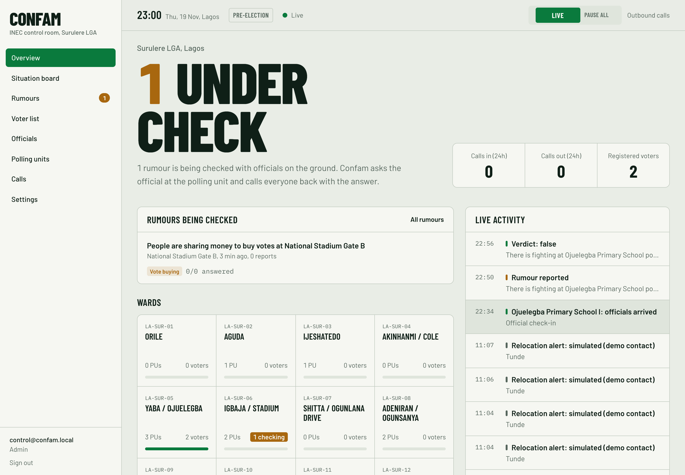
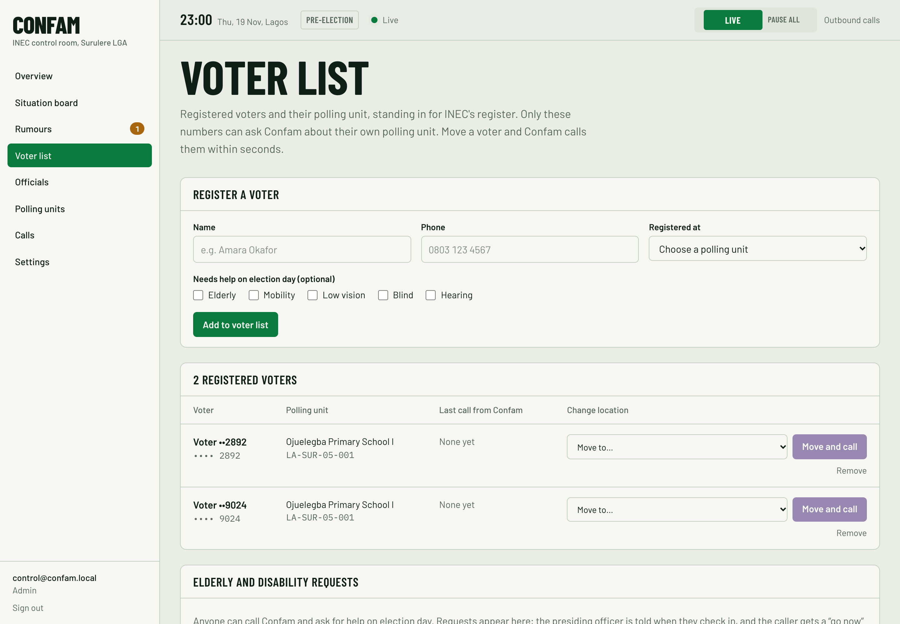
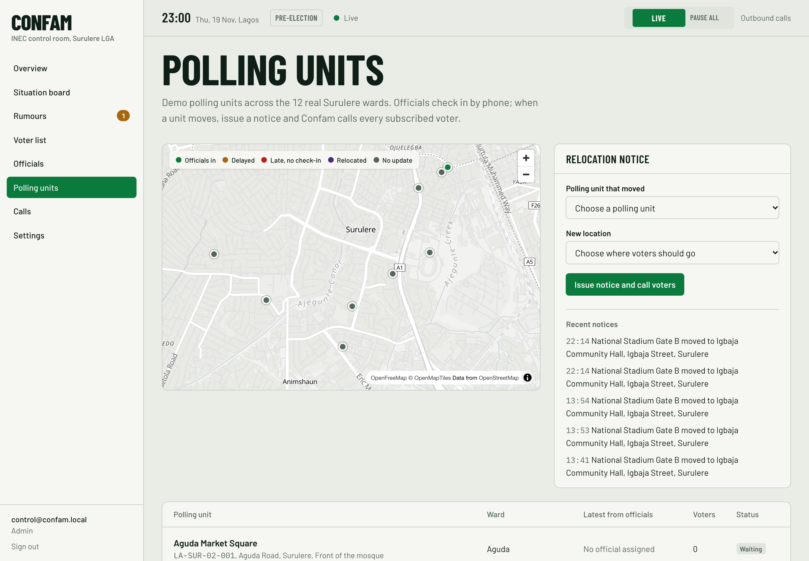
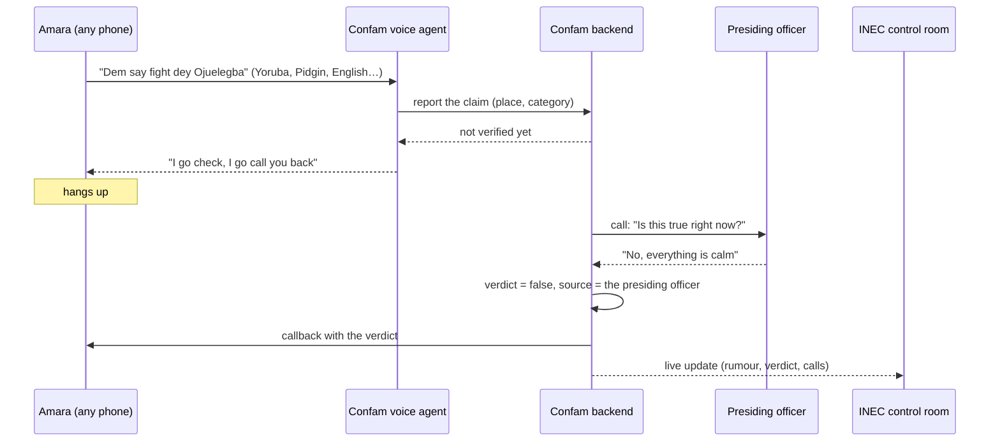
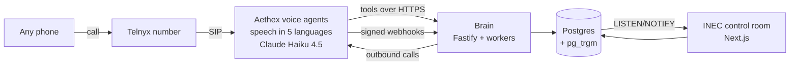

# Confam

**A phone number that tells Nigerian voters what's true on election day, and calls them when something changes.**

*Built for K-Tech Fest, "Every Vote, Every Voice".* · **[▶ Demo video (3:35)](https://drive.google.com/file/d/1W2PJHUGUODDTcSwBAaNOV5R_dVBmCklx/view?usp=sharing)** · [Website](https://web-production-13f1563e.up.railway.app) · [INEC control room](https://web-production-13f1563e.up.railway.app/control) · [One-page problem brief](docs/problem-brief.md) · Call Confam: **+1 864 808 9401**

[](https://drive.google.com/file/d/1W2PJHUGUODDTcSwBAaNOV5R_dVBmCklx/view?usp=sharing)

**▶ [Watch the 3½-minute demo](https://drive.google.com/file/d/1W2PJHUGUODDTcSwBAaNOV5R_dVBmCklx/view?usp=sharing)**: Amara's election morning, first without Confam, then with it. The calls you hear in scenes 1–3 are real Confam calls, recorded live against the production system while the real INEC control room updated on screen.

---

## Amara's morning

It's election day in Surulere, Lagos. Amara has her voter's card and an ₦8,000 keypad phone. No WhatsApp, no data.

She walks to the primary school where she voted last time and finds out **her polling unit moved**. INEC sent a text two weeks ago, but it was lost in a pile of bank alerts and promos. When she finds the new place, the queue is long and **nobody can tell her if the officials are coming**. Then a neighbour shows her a voice note: *"Dem dey fight for Ojuelegba, no go there."* Is it true? There's no way to check. Half the queue goes home.

Her father is 78. He wants to vote, but standing in a queue for three hours isn't possible, and nobody has told him he doesn't have to.

None of this is about ballot boxes or result sheets. **It's about information.** Each problem is a small piece of missing or false information, and together they decide whether people vote and whether they trust what happens next.

## Where Confam fits in the voting chain

```
Inform voters  ──►  Identify voters  ──►  Move staff & materials  ──►  Vote & count  ──►  Transmit results  ──►  Disputes
   ▲ Confam                                  ▲ Confam
```

We chose the first weak link: **getting accurate information to voters and stopping rumours**, plus **knowing where officials are on the morning of the vote**. If voters can't get the truth, every later link suffers: turnout drops, rumours fill the gap, and people stop believing results.

## Why a phone call

Most election tech assumes a smartphone, data and the ability to read English. Many of the people who most need help have none of these: older voters, rural voters, people on ₦8,000 phones, people who read Yoruba or Hausa better than English, or not at all.

Almost everyone can make a phone call. So Confam lives there. You call a number and talk the way you talk at home, in **Yoruba, Hausa, Igbo, Pidgin, English or a mix**, and Confam understands you and answers right away. No app, no data, no forms, and no need to read.

## What happens when Amara has Confam

**A rumour starts.** Amara calls and says, in Yoruba, *"they say there's fighting at Ojuelegba."* Confam doesn't guess. It says it will check, and the moment she hangs up it **phones the presiding officer at that polling unit**: *"A voter just reported fighting near Ojuelegba Primary School. Is that true right now?"* The officer says no. Seconds later Confam **calls Amara back**: *"Not true. The presiding officer at Ojuelegba Primary School confirmed it directly."* The next person who asks gets the answer immediately, because Confam remembers what it has verified, for as long as it stays fresh.

**Her polling unit moves.** In the INEC control room, an official moves Amara to St. Mary's Catholic School. **Her phone rings within seconds**, with the new address and a landmark she knows. It's a call she can't miss, not a text she won't read.

**Officials are late.** Amara calls: *"Have the officials reached Ojuelegba?"* Confam answers from the presiding officer's own check-in: *"Yes, they arrived at 7:42."* If officials haven't checked in by the opening deadline, Confam **calls the presiding officer** to ask why, then their supervisor.

**Her father needs help.** He calls Confam and says he's old and can't stand for long. Confam tells him his rights: he doesn't have to queue, and he can bring a helper he trusts (but never a party agent). It warns the officials at his polling unit, then **calls him back when they're ready**: *"The officials are there and know you're coming. You can go now."*

**Someone who isn't registered calls.** They can still ask about rumours and whether officials have arrived. If they ask *"where do I vote?"*, Confam tells them kindly to register with INEC first. Only people on the voter list get information about their own polling unit.

## The INEC control room

Every call, verdict and check-in shows up live in a web dashboard for election officials. This is how INEC runs Confam, and how a judge can test it with their own phone number.

| Page | What officials do there |
|---|---|
| **Overview** | Live activity feed, ward board for all 12 Surulere wards, rumours being checked, and a **pause-all switch** that stops every outbound call at once |
| **Situation board** | Everything Confam currently "knows" and will answer instantly, and how long each answer stays valid |
| **Rumours** | Each rumour, who reported it and in what words, what the official answered, the verdict, and who was called back. Officials can **override a verdict**; everyone who reported it gets a correction call |
| **Voter list** | The register (a stand-in for INEC's). **Move a voter** and Confam calls them immediately. Elderly and disability requests appear here too |
| **Officials** | Register presiding officers (each gets a private 4-digit PIN for check-ins), see their latest check-in, reset PINs |
| **Polling units** | Live map of every unit coloured by officials' status; issue a **relocation notice** that calls every registered voter of that unit |
| **Calls** | Every call with its full transcript, and every outbound decision with the reason a call was or wasn't placed |



<table>
<tr>
<td></td>
<td></td>
</tr>
</table>

## Trust rules built into Confam

- **Confam never makes up a verdict.** The voice agent can only repeat answers the system produced from an official's own words, and every verdict says who confirmed it.
- **The person at the polling unit decides.** One presiding officer's answer settles a rumour about their unit. If no clear answer comes in time, Confam says "we could not confirm" and points people to official INEC channels.
- **Officials prove who they are.** A check-in only counts if it comes from the official's registered phone **and** includes their PIN. Five wrong tries locks check-ins for an hour.
- **Politically neutral, and safety first.** Confam never endorses a party or candidate. Anyone in danger is told to move to safety and call 112, and no one is ever asked to go and check a dangerous place.
- **People stay in control.** Voters are called only after INEC registers them, or after they agree to a callback. "Stop calling me" works at any time, and phone numbers are encrypted and shown masked everywhere.
- **No phone voting.** The Electoral Act 2026 (s.55) requires voting in person, so Confam helps people get to the polls instead.

## How it works



One phone number connects to one voice agent for incoming calls. Three more agents make outgoing calls: one asks officials, one delivers alerts, one chases late officials. They all share one backend that remembers what is true and decides who to call.

## How AI is used

AI does the **language work**. Plain code makes the **decisions**.

- **Understanding callers.** Aethex's speech recognition turns what a caller says into text, in Yoruba, Hausa, Igbo, Pidgin, English or a mix. Claude Haiku 4.5 (running inside Aethex) works out what they want, turns a rumour into one short neutral English sentence with a category and a place, and decides which Confam tool to use.
- **Talking back.** The same model phrases short spoken replies, and Aethex's Nigerian-accented voices speak them.
- **What AI never does:** decide whether a rumour is true, choose who to call, or invent a verdict. Verdicts come only from an official's recorded answer and fixed rules in our backend (one presiding officer's answer settles it; no answer means "unverified"). The voice agent can only read out verdict text the backend wrote, and every verdict names who confirmed it.
- **Grouping rumours.** The same rumour said in different words is matched with fuzzy text search in Postgres (pg_trgm), not an AI model, so results are predictable and fast.

## Under the hood



| Layer | What we use | Why |
|---|---|---|
| Phone number | **Telnyx** | Carries the calls; connected to Aethex over SIP |
| Voice | **Aethex AI** voice agents, Nigerian-accented voices | Understands callers in Yoruba, Hausa, Igbo, Pidgin, English and mixes of them (we tested it with native-speaker recordings), with low-latency turn-taking |
| Language model | **Claude Haiku 4.5** (through Aethex) | Fast enough for natural conversation; understands all five languages |
| Backend ("brain") | **Node 24, TypeScript, Fastify, Zod** | The tools the agents call during a call, signed webhooks, and the rules for verdicts and calls |
| Jobs | **pg-boss** on Postgres | Durable background work: calling officials, callbacks, retries, the lateness sweep |
| Database | **Postgres 16 + Drizzle ORM + pg_trgm** | Voters, officials, rumours, verdicts and calls. Fuzzy matching groups the same rumour said in different words |
| Control room | **Next.js 16, React 19, Tailwind 4, Motion, MapLibre** | Live dashboard updated over server-sent events from Postgres LISTEN/NOTIFY |
| Hosting | **Railway** | Brain, control room and Postgres in one project |
| Quality | **Vitest** (55 backend tests), **Playwright** (16 browser tests on desktop and mobile), GitHub Actions CI | Every change is tested before deploy, and again on the live site |

A few details that make it work on real Nigerian phone lines:
- **Speed.** The agent answers without looking anything up first. Aethex sends the caller's number with every tool request, so our tools answer in milliseconds.
- **Dual-SIM safe.** Confam waits until a reporter hangs up before calling the official, in case both numbers are in the same phone, and tries 3 times.
- **Messy caller IDs.** Nigerian numbers sometimes arrive as `+1 234…` or `+234 0…`. Confam repairs them, so callbacks reach the right person.
- **Answers are never lost.** If an official answers but the agent fails to record it, the backend reads the yes or no from the call transcript.

Full design: [ARCHITECTURE.md](ARCHITECTURE.md) · Research and sources: [docs/research.md](docs/research.md)

## Try it

1. **Call +1 864 808 9401** and ask *"Where is Ojuelegba Primary School polling unit?"*, or report a rumour, in whatever language you speak.
2. **Open the control room** at https://web-production-13f1563e.up.railway.app/control. The judge login is already filled in, so just press **Sign in**. Add your own number to the **Voter list**, then press **Move and call**.
3. Register yourself under **Officials** to receive Confam's verification calls when someone reports a rumour at your polling unit.

The demo covers the 12 real wards of Surulere LGA. The polling units in it are demo records, because INEC's polling-unit directory isn't publicly downloadable.

## Run it yourself

```bash
npm ci
cp .env.example .env           # fill in Aethex, Telnyx and secret values
npm run db:migrate && npm run db:seed
npm run dev:brain              # tools, webhooks and workers on :8787 (expose it with ngrok)
npm run provision:aethex -w @confam/brain -- --write-env --connect-number
npm run dev -w @confam/web     # control room on http://localhost:3100
```

Tests: `npm test -w @confam/brain` (needs Postgres) and `npx playwright test -c apps/web` (needs a running build).

## Honest limits

- **The number is American (+1 864 808 9401).** We had 48 hours, and getting a Nigerian number takes regulatory paperwork we couldn't finish in time. Two side effects you may notice: calling it from Nigeria is an international call, and Confam's calls to Nigerian phones sometimes show up as a random local number, because international routes into Nigeria often replace the caller ID. A Nigerian number fixes both.
- **About the demo video.** Amara, Baba and the presiding officer are AI-generated characters with AI voices; the film shots were generated. Confam's side of the calls in scenes 1–3 is the real agent answering live, and the control room footage is the real dashboard. Our voice-agent credits ran out before the rumour scene, so scene 4's call audio is re-enacted from Confam's real production scripts (the rumour case shown in the control room is a real one, verified by a real official on a real call). The video says this on screen.
- **The voter list and polling units are demo data.** The 12 Surulere wards are real; the polling units and voter list stand in for INEC's register, which isn't public.

## What's next

- **A Nigerian phone number** through Africa's Talking (which Aethex already integrates) or a Telnyx +234 number, so Confam is a local call and shows a proper local caller ID.
- **INEC's real register and polling-unit directory** in place of the demo data, matched by voter ID (VIN) and phone number.
- **Results verification:** the same "ask the person on the ground" method can check a photographed result sheet against what officials uploaded.

## Credits and AI declaration

**AI coding assistant:** Claude.

**AI models used in the product**
- [Aethex AI](https://aethexai.com) voice agents: speech recognition, turn-taking and Nigerian-accented voices.
- [Claude Haiku 4.5](https://www.anthropic.com/claude) by Anthropic, as the agents' language model (through Aethex).
- [Higgsfield](https://higgsfield.ai) (GPT Image model) for the landing-page photographs of Amara, her father and the presiding officer. They are AI-generated illustrations, not real people.

**Services and APIs**
- [Telnyx](https://telnyx.com) phone number and voice routing.
- [Railway](https://railway.com) hosting for the backend, control room and Postgres.
- [OpenFreeMap](https://openfreemap.org) map tiles, using [OpenStreetMap](https://www.openstreetmap.org/copyright) data © OpenStreetMap contributors.

**Data**
- Surulere ward names: INEC's ward list as compiled in [dharmzeey/webscraping-electoral](https://github.com/dharmzeey/webscraping-electoral). Polling units, voters and officials in the demo are demo records.
- Native-speaker speech used only to *test* language understanding (not shipped): [shunyalabs/yoruba-speech-dataset](https://huggingface.co/datasets/shunyalabs/yoruba-speech-dataset), [shunyalabs/hausa-speech-dataset](https://huggingface.co/datasets/shunyalabs/hausa-speech-dataset), [mkg25gpx/igbosyncorp-igbo-asr-benchmark](https://huggingface.co/datasets/mkg25gpx/igbosyncorp-igbo-asr-benchmark) on Hugging Face.
- Legal and research sources: the [Electoral Act 2026](https://thewest.ng/wp-content/uploads/2026/03/ElectoralAct2026.pdf) (s.47, s.54, s.55), INEC regulations and reports, and reporting from Dubawa, the Reuters Institute, TheCable, Dataphyte, PLAC and others. Every claim is linked in [docs/research.md](docs/research.md).

**Open-source libraries:** Next.js, React, Tailwind CSS, Motion, GSAP, Lenis, MapLibre GL JS, Fastify, Zod, Drizzle ORM, node-postgres, pg-boss, jose, pino, Vitest, Playwright and TypeScript, under their respective licences.

---

Repository layout: `apps/brain` (voice tools, webhooks, workers), `apps/web` (INEC control room), `packages/db` (schema, migrations, phone encryption, seed). See [VERIFY.md](VERIFY.md) for how every release is checked.
